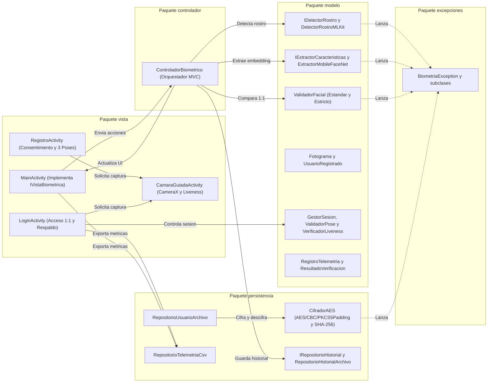

# Sistema de Verificación de Identidad Biométrica Facial 1:1 en Android

Aplicación móvil desarrollada en **Android (Java)** que ejecuta la verificación biométrica facial 1:1 completamente en el dispositivo (*on-device*), sin servidores externos. Integra **CameraX**, **Google ML Kit Face Detection** y **TensorFlow Lite (`mobilefacenet.tflite`)** bajo una arquitectura **MVC** orientada a objetos.

## Información Académica

* **Institución:** Universidad Distrital Francisco José de Caldas
* **Asignatura:** Programación Orientada a Objetos (2.º Semestre)
* **Autor:** Samuel Santiago Ramos Pedraza
* **Docente:** David Gustavo Rosero Bernal

---

## Características Principales

### 1. Registro Biométrico Seguro y Guiado
* **Consentimiento informado obligatorio:** Requiere aceptación explícita antes de habilitar la captura facial (`RegistroActivity`).
* **Prueba de vida activa aleatoria (`VerificadorLiveness`):** Desafío en tiempo real (`<= 8 s`) que alterna entre parpadeo, giro a la izquierda o giro a la derecha para mitigar ataques con fotografías estáticas.
* **Captura guiada en 3 poses (`CamaraGuiadaActivity` y `ValidadorPose`):** Adquiere secuencialmente las poses `Frontal`, `Izquierda` y `Derecha`, verificando en todo momento que exista exactamente **1 solo rostro** en cuadro.
* **Almacenamiento cifrado (`CifradorAES` y `RepositorioUsuarioArchivo`):** Protege el perfil biométrico y sus tres *embeddings* mediante cifrado simétrico **`AES/CBC/PKCS5Padding`** con vector de inicialización aleatorio y resumen criptográfico **`SHA-256`** para la contraseña de respaldo.

### 2. Inicio de Sesión Biométrico 1:1 y Control de Acceso
* **Verificación multipose 1:1 (`ValidadorFacial`):** Evalúa el fotograma capturado tras superar el *Liveness* activo frente a las tres poses registradas aplicando similitud coseno (`max(s1, s2, s3) >= umbral`).
* **Respaldo por contraseña y gestión de sesión (`GestorSesion`):** Permite autenticación alternativa mediante verificación del hash `SHA-256`, cierre de sesión explícito y **bloqueo temporal de 30 s tras 3 intentos fallidos** consecutivos.
* **Modo dual de validación:** Permite alternar polimórficamente entre `ValidadorEstandar` (`umbral = 0.70`) y `ValidadorEstricto` (`umbral = 0.82` con verificación de ángulos de pose y ojos abiertos).

### 3. Telemetría Experimental en CSV
* **Registro automático (`RegistroTelemetria` y `RepositorioTelemetriaCsv`):** Exporta los experimentos al archivo `telemetria_experimentos.csv` (delimitado por `;`) con las siguientes métricas:
  * Condición de iluminación (`Buena`, `Baja`, `Contraluz`).
  * Tipo de prueba / intento, modo del validador y resultado de la prueba de vida.
  * Tiempos de detección con **ML Kit** (ms) e inferencia con **TensorFlow Lite** (ms).
  * Uso de memoria RAM mediante `Runtime.getRuntime()` (MB) y tamaño del modelo `mobilefacenet.tflite` (MB).
  * Similitud coseno máxima, umbral aplicado y veredicto final.

---

## Arquitectura MVC por Paquetes

La aplicación organiza sus responsabilidades en cinco paquetes bajo `co.edu.udistrital.reconocimientofacial`: `vista`, `controlador`, `modelo`, `persistencia` y `excepciones`.



---

## Pilares de Programación Orientada a Objetos Implementados

| Pilar POO | Implementación en el Proyecto |
| :--- | :--- |
| **Encapsulamiento** | Atributos privados con **copias defensivas** (`Arrays.copyOf` / `new Rect(...)`) para proteger vectores *embedding* y datos internos en `Fotograma` y `UsuarioRegistrado`. |
| **Abstracción (Interfaces)** | Contratos desacoplados mediante `IDetectorRostro`, `IExtractorCaracteristicas`, `IRepositorioHistorial` e `IVistaBiometrica` para separar lógica, detección, persistencia e interfaz gráfica. |
| **Herencia y Polimorfismo** | Clase abstracta `ValidadorFacial` con método plantilla `verificar(...)` y `verificarContraPerfil(...)`, especializada en `ValidadorEstandar` (`tau = 0.70`) y `ValidadorEstricto` (`tau = 0.82` con control de pose y apertura ocular). |
| **Manejo de Excepciones Propias** | Excepción comprobada base `BiometriaException` (con código de error encapsulado) y jerarquía especializada: `RostroNoDetectadoException`, `MultiplesRostrosException`, `CalidadInsuficienteException` y `ModeloNoDisponibleException`. |

---

## Compilación y Pruebas Unitarias

Desde la raíz del proyecto en Windows (PowerShell o CMD):

* **Compilar APK de depuración:**
  ```powershell
  .\gradlew.bat assembleDebug
  ```
* **Ejecutar pruebas unitarias locales:**
  ```powershell
  .\gradlew.bat testDebugUnitTest
  ```

---

## Referencias Bibliográficas

1. **Ma, H., Guo, D., Wang, J., et al. (2026).** *Real-time face recognition algorithm based on lightweight neural network in the field of computer vision*. Discover Applied Sciences, 8, 33. DOI: `10.1007/s42452-025-08004-y`.
2. **El Fadel, N. (2025).** *Facial Recognition Algorithms: A Systematic Literature Review*. Journal of Imaging, 11(2), 58. DOI: `10.3390/jimaging11020058`.
3. **Chen, S., Liu, Y., Gao, X., & Han, Z. (2018).** *MobileFaceNets: Efficient CNNs for Accurate Real-Time Face Verification on Mobile Devices*. Chinese Conference on Biometric Recognition (CCBR) / arXiv:1804.07573.
