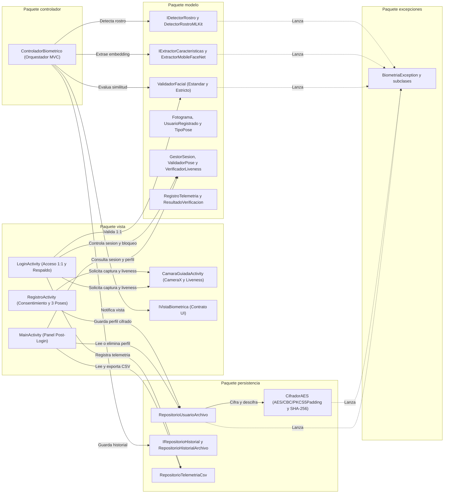

# Sistema de Verificación de Identidad Biométrica desde Dispositivos Móviles

Aplicación móvil desarrollada en **Android (Java 11, `minSdk 24`, `targetSdk 37`)** que ejecuta verificación biométrica facial 1:1 completamente en el dispositivo (*on-device*), sin servidores externos ni conexión a internet. Integra **CameraX (`1.4.2`)**, **Google ML Kit Face Detection (`16.1.7`)** y **TensorFlow Lite (`2.16.1`, `mobilefacenet.tflite` de `4.99 MB`)** bajo una arquitectura **MVC** orientada a objetos.

## Información Académica

* **Universidad:** Universidad Distrital Francisco José de Caldas
* **Facultad y Programa:** Facultad de Ingeniería — Programa de Ingeniería Eléctrica
* **Asignatura:** Programación Orientada a Objetos
* **Autor:** Samuel Santiago Ramos Pedraza (Código `20261007053`)
* **Docente:** David Gustavo Rosero Bernal

---

## Funcionamiento Principal

### 1. Registro Guiado y Cifrado Local (`RegistroActivity`, `CamaraGuiadaActivity`, `CifradorAES`, `RepositorioUsuarioArchivo`)
* **Doble validación de consentimiento informado:** La pantalla de registro exige marcar el consentimiento antes de habilitar la captura facial, y `RepositorioUsuarioArchivo.guardarUsuario(...)` vuelve a comprobarlo lanzando `BiometriaException` (`BIO-USU-01`) si falta la aceptación.
* **Prueba de vida activa (`VerificadorLiveness`):** Antes de capturar los vectores exige superar un reto aleatorio en máximo `8 s` (`PARPADEO`, `GIRO_IZQUIERDA` o `GIRO_DERECHA`) verificando siempre que haya un único rostro en escena.
* **Captura en tres poses (`ValidadorPose`):** Adquiere en orden las poses `FRONTAL`, `IZQUIERDA` y `DERECHA` y extrae tres vectores (*embeddings*) normalizados de `192` dimensiones con MobileFaceNet.
* **Almacenamiento privado cifrado:** Guarda el perfil en `usuario_cifrado.dat` (`context.getFilesDir()`) usando cifrado simétrico `AES/CBC/PKCS5Padding` con clave derivada `SHA-256` e IV aleatorio de `16` bytes (`SecureRandom`). La contraseña de respaldo se guarda únicamente como resumen `SHA-256`.

### 2. Inicio de Sesión Biométrico 1:1 y Respaldo (`LoginActivity`, `ValidadorFacial`, `GestorSesion`)
* **Verificación multipose 1:1:** Tras superar la prueba de vida activa (`<= 8 s`), compara la captura frontal contra las tres poses registradas mediante similitud coseno máxima (`max(s1, s2, s3) >= umbral`).
* **Modo dual polimórfico:** Permite alternar entre `ValidadorEstandar` (`umbral = 0.65`) y `ValidadorEstricto` (`umbral = 0.83`, con verificación adicional de `|yaw| <= 18°`, `|roll| <= 18°` y apertura ocular `>= 0.50`).
* **Respaldo por contraseña y bloqueo compartido:** Permite ingresar validando el hash `SHA-256` de la contraseña y comparte el contador de fallos con la biometría: tras `3` intentos fallidos seguidos, bloquea ambos botones durante `30 s`.

### 3. Panel Post-Login y Telemetría (`MainActivity`, `RepositorioTelemetriaCsv`)
* **Panel autenticado (`MainActivity`):** Muestra el estado de la sesión activa, el resumen del perfil cifrado, los últimos `8` registros guardados en `telemetria_experimentos.csv`, y controles para exportar o limpiar el CSV, cerrar sesión o eliminar el perfil local.
* **Exportación automática a CSV:** Registra fecha, usuario, tipo de intento, iluminación (`Buena`, `Baja`, `Contraluz`), modo del validador, resultado y desafío de *liveness*, tiempos de ML Kit y TFLite (ms), uso de memoria RAM (MB), tamaño del modelo (MB), similitud máxima, umbral y veredicto.

---

## Arquitectura MVC por Paquetes

El proyecto organiza las clases bajo `co.edu.udistrital.reconocimientofacial` en cinco paquetes (`vista`, `controlador`, `modelo`, `persistencia` y `excepciones`), más `MainActivity` en el paquete raíz para el panel posterior al inicio de sesión.



| Paquete | Clases e interfaces | Responsabilidad principal |
| :--- | :--- | :--- |
| **`vista`** | `LoginActivity`, `RegistroActivity`, `CamaraGuiadaActivity`, `IVistaBiometrica` *(y `MainActivity` en raíz)* | Gestiona las pantallas, permisos de cámara, flujo guiado de *liveness* y poses, bloqueo visual de `30 s` y panel post-login. |
| **`controlador`** | `ControladorBiometrico` | Coordina detección, extracción, validación polimórfica y guardado de historial sin acoplar el dominio a la UI. |
| **`modelo`** | `IDetectorRostro`, `DetectorRostroMLKit`, `IExtractorCaracteristicas`, `ExtractorMobileFaceNet`, `Fotograma`, `UsuarioRegistrado`, `TipoPose`, `ValidadorFacial`, `ValidadorEstandar`, `ValidadorEstricto`, `ResultadoVerificacion`, `GestorSesion`, `ValidadorPose`, `VerificadorLiveness`, `RegistroTelemetria` | Contiene entidades en Java puro (salvo los adaptadores de ML Kit y TFLite), similitud coseno multipose, estados de *liveness*, rangos de pose y sesión. |
| **`persistencia`** | `CifradorAES`, `RepositorioUsuarioArchivo`, `IRepositorioHistorial`, `RepositorioHistorialArchivo`, `RepositorioTelemetriaCsv` | Implementa cifrado AES y resúmenes `SHA-256`, lectura/escritura cifrada del perfil y manejo de archivos CSV. |
| **`excepciones`** | `BiometriaException`, `RostroNoDetectadoException`, `MultiplesRostrosException`, `CalidadInsuficienteException`, `ModeloNoDisponibleException` | Define excepciones comprobadas con códigos de error (`BIO-001` a `BIO-004`, entre otros) para reportar fallos del dominio. |

---

## Pilares de Programación Orientada a Objetos

| Pilar POO | Implementación en el proyecto |
| :--- | :--- |
| **Encapsulamiento** | Atributos privados con **copias defensivas** (`Arrays.copyOf` y `new Rect(...)`) para proteger los *embeddings* de `192` datos y coordenadas en `Fotograma` y `UsuarioRegistrado`. |
| **Abstracción con Interfaces** | Contratos desacoplados en `IDetectorRostro`, `IExtractorCaracteristicas`, `IRepositorioHistorial` e `IVistaBiometrica` para separar detección, inferencia, persistencia e interfaz. |
| **Herencia y Polimorfismo** | Clase abstracta `ValidadorFacial` con métodos plantilla `verificar(...)` y `verificarContraPerfil(...)`, especializada en `ValidadorEstandar` (`0.65`) y `ValidadorEstricto` (`0.83` con control de ángulo y ojos). |
| **Excepciones Propias** | Excepción comprobada base `BiometriaException` (con `codigoError`) y subclases `RostroNoDetectadoException`, `MultiplesRostrosException`, `CalidadInsuficienteException` y `ModeloNoDisponibleException`. |

---

## Pruebas Unitarias y Resultados Experimentales Reales

### Pruebas Unitarias en JUnit 4 (`27/27` aprobadas)
* `ValidadorFacialTest` (`8` pruebas): copias defensivas, normalización L2, polimorfismo estándar/estricto, `CalidadInsuficienteException`, `verificarContraPerfil` (`max(s1, s2, s3)`) e historial.
* `GestorSesionTest` (`6` pruebas): ingreso por clave, ingreso biométrico 1:1, bloqueo de `30 s` tras `3` fallos mixtos, desbloqueo automático y cierre de sesión.
* `PoseYLivenessTest` (`7` pruebas): control de `1` rostro, rangos de `FRONTAL`/`IZQUIERDA`/`DERECHA`, secuencia de parpadeo, vencimiento a los `8 s` y giros pasando por frontal.
* `SeguridadYPersistenciaTest` (`6` pruebas): cifrado/descifrado AES, IV distinto por ejecución, rechazo de clave errónea, bloqueo por falta de consentimiento (`BIO-USU-01`) y exportación CSV.

### Calibración y Métricas en Dispositivo Real (`18` ensayos)
Los datos reales capturados en dispositivo físico se encuentran en [`docs/telemetria_experimentos_real.csv`](docs/telemetria_experimentos_real.csv) (`14` intentos `GENUINO`, `1` `IMPOSTOR` y `3` `SPOOFING`):
* **`ValidadorEstandar` (`umbral = 0.65`):** Exactitud de **`83.33%`** (`15/18`), FRR de **`14.29%`** (`2/14`) y FAR de `25.00%` (`1/4`).
* **`ValidadorEstricto` (`umbral = 0.83`):** FAR de **`0.00%`** (`0/4`) al bloquear el ataque de *spoofing* de `0.8208`, con FRR de `71.43%` (`10/14`) y control de pose (`|yaw| <= 18°`, `|roll| <= 18°`, apertura ocular `>= 0.50`).
* **Rendimiento promedio (`n = 17` inferencias completas):** Detección ML Kit **`43.3 ms`**, inferencia MobileFaceNet TFLite **`42.6 ms`**, **latencia total `85.9 ms`**, **RAM promedio `17.36 MB`** (`n = 18`) y tamaño del modelo **`4.99 MB`**.

---

## Compilación y Ejecución de Pruebas

Desde la raíz del proyecto en Windows (PowerShell):

* **Ejecutar pruebas unitarias locales:**
  ```powershell
  .\gradlew.bat testDebugUnitTest
  ```
* **Compilar APK de depuración (generado en `app/build/outputs/apk/debug/app-debug.apk`):**
  ```powershell
  .\gradlew.bat assembleDebug
  ```

---

## Referencias Bibliográficas

1. **Chen, S., Liu, Y., Gao, X., & Han, Z. (2018).** *MobileFaceNets: Efficient CNNs for accurate real-time face verification on mobile devices*. En *Biometric Recognition (CCBR 2018)*, Springer (`arXiv:1804.07573`).
2. **El Fadel, N. (2025).** *Facial recognition algorithms: A systematic literature review*. *Journal of Imaging*, 11(2), 58 (`10.3390/jimaging11020058`).
3. **Ma, H., Guo, D., Wang, J., Li, P., Xu, C., & Wang, Y. (2026).** *Real-time face recognition algorithm based on lightweight neural network in the field of computer vision*. *Discover Applied Sciences*, 8, 33 (`10.1007/s42452-025-08004-y`).
