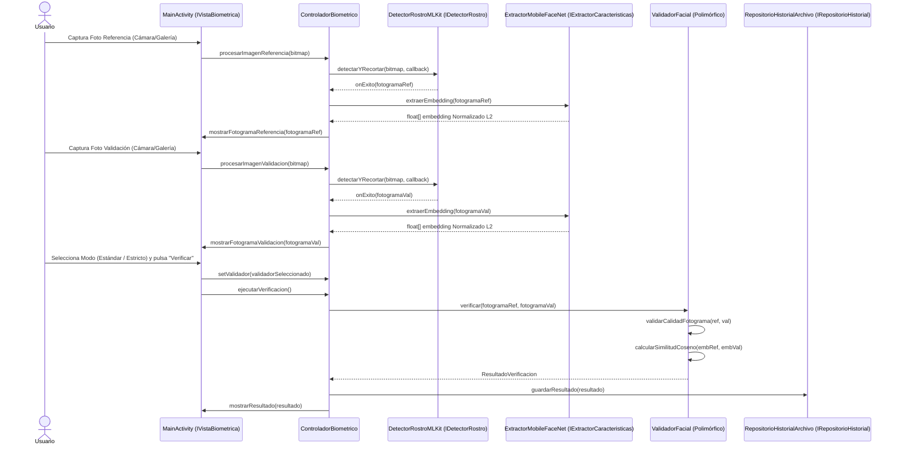

# Sistema de Verificación de Identidad Biométrica Facial 1:1 en Dispositivo (Android Java / POO)

*   **Author:** Samuel Santiago Ramos Pedraza (HEBA102514)
*   **Status:** Draft
*   **Date:** 2026-11-08

--------------------------------------------------------------------------------

## Overview

Este documento especifica el diseño de una aplicación móvil para Android escrita en Java (`namespace co.edu.udistrital.reconocimientofacial`) que realiza verificación de identidad biométrica facial 1:1 directamente en el teléfono, sin depender de servidores externos ni conexión a internet. El proyecto corresponde a la segunda entrega del curso de Programación Orientada a Objetos (segundo semestre de Ingeniería Eléctrica en la Universidad Distrital Francisco José de Caldas, docente David Gustavo Rosero Bernal).

El sistema toma dos fotografías estáticas (una imagen de referencia y una imagen de validación), detecta y recorta el rostro mediante Google ML Kit Face Detection, extrae el vector numérico de características (*embedding*) usando una red neuronal ligera MobileFaceNet en TensorFlow Lite (`.tflite`), y calcula la similitud coseno entre ambos vectores para determinar si corresponden a la misma persona. El diseño traduce las etapas, métricas y restricciones de las dos fuentes bibliográficas de la propuesta —Ma et al. (2026) [1] y El Fadel (2025) [2]— a una arquitectura orientada a objetos bajo el patrón Modelo-Vista-Controlador (MVC).

## The Problem

En la primera entrega del proyecto se planteó una arquitectura híbrida entre el teléfono y la nube (*Edge-Cloud*) para evitar dos limitaciones de la biometría móvil:
1. Los modelos pesados de reconocimiento facial (como ArcFace completo) exigen más capacidad de cómputo y memoria de la que un teléfono de gama media puede sostener sin alta latencia ni consumo excesivo de batería.
2. Transmitir video continuo hacia un servidor externo consume ancho de banda, introduce demoras de red y expone datos biométricos sensibles fuera del dispositivo.

Sin embargo, construir y mantener un servidor en la nube añade costos de infraestructura y obliga a programar un servicio externo ajeno a los objetivos del curso de Programación Orientada a Objetos en Java. Al mismo tiempo, para un estudiante de segundo semestre con un plazo de entrega de menos de 24 horas, existen dos riesgos opuestos:
* **Riesgo de complejidad accidental en Android:** Intentar procesar video en tiempo real con `CameraX` y convertir tramas `YUV_420_888` desvía el esfuerzo hacia problemas de concurrencia y rotación de sensores, impidiendo terminar el proyecto a tiempo.
* **Riesgo de diseño procedural («código pegamento»):** Concentrar las llamadas a ML Kit y TensorFlow Lite dentro de [`MainActivity`](file:///c:/Users/User/AndroidStudioProjects/Reconocimientofacial/app/src/main/java/co/edu/udistrital/reconocimientofacial/MainActivity.java) incumpliría la rúbrica de POO del curso, que exige demostrar encapsulamiento, interfaces, clases abstractas, polimorfismo en tiempo de ejecución, manejo de excepciones propias, separación MVC y persistencia en archivos.

La solución propuesta resuelve ambos problemas ejecutando la verificación 1:1 en el propio teléfono sobre dos capturas estáticas con permiso de cámara (apoyada en el modelo ligero MobileFaceNet sustentado por Ma et al., 2026 [1]) y organizando el flujo biométrico de cuatro etapas de El Fadel (2025) [2] en una jerarquía de clases desacoplada en Java.

## Goals

*   **G1 — Verificación biométrica 1:1 local en 4 etapas:** Ejecutar en el teléfono el ciclo completo definido en la propuesta y en El Fadel (2025) [2]: (1) captura de imagen de referencia e imagen de validación con permiso de cámara, (2) detección y recorte del rostro con ML Kit almacenado en un objeto `Fotograma`, (3) extracción de *embeddings* normalizados en norma $L_2$ con MobileFaceNet (`.tflite`) según Ma et al. (2026) [1], y (4) comparación por similitud coseno contra un umbral $\tau$ que devuelve el veredicto (`COINCIDE` / `NO COINCIDE`) junto con la latencia en milisegundos.
*   **G2 — Cumplimiento verificable de la rúbrica de POO:** Implementar explícitamente:
    *   **Encapsulamiento:** Clase `Fotograma` con atributos privados y copias defensivas del arreglo `float[] embedding`.
    *   **Interfaces:** Contratos desacoplados para detección (`IDetectorRostro`), extracción (`IExtractorCaracteristicas`), persistencia (`IRepositorioHistorial`) y vista (`IVistaBiometrica`).
    *   **Clases abstractas y polimorfismo:** Jerarquía `ValidadorFacial` con método plantilla y dos subclases intercambiables en tiempo de ejecución (`ValidadorEstandar` con $\tau = 0.70$ y `ValidadorEstricto` con $\tau = 0.82$ más validación de pose y apertura ocular).
    *   **Excepciones propias:** Jerarquía comprobada (`BiometriaException` y sus subclases) para capturar errores de rostro ausente, múltiples rostros, baja calidad de pose/ojos o ausencia del archivo `.tflite`.
    *   **Patrón MVC y persistencia en archivos:** Separación en paquetes `modelo`, `vista`, `controlador`, `persistencia` y `excepciones`, guardando cada resultado en un archivo plano CSV local (`historial_verificaciones.csv`).
*   **G3 — Implementación realizable en menos de 24 horas:** Emplear contratos estándar de AndroidX (`RequestPermission`, `TakePicturePreview` y `GetContent`) para evitar bloqueos de configuración de cámara o `FileProvider`.

## Non-Goals

*   **NG1 — Procesamiento de video continuo en tiempo real (`CameraX`):** No se analizarán flujos de video a 30 FPS ni secuencias temporales de parpadeo en vivo en esta entrega.
*   **NG2 — Arquitectura en la nube o identificación 1:N:** No se implementarán servidores remotos, APIs REST ni búsqueda contra bases de datos de múltiples usuarios.
*   **NG3 — Entrenamiento de redes neuronales o anti-spoofing por hardware:** No se entrenarán modelos desde cero ni se usarán sensores infrarrojos/de profundidad; se utilizará un archivo `mobilefacenet.tflite` preentrenado.

## Open Questions

*   Ninguna pregunta abierta pendiente. Las decisiones sobre el alcance de cámara estática, el polimorfismo de `ValidadorFacial` y la persistencia en archivos CSV fueron acordadas en la fase previa ([concepts_brief.md](file:///c:/Users/User/AndroidStudioProjects/Reconocimientofacial/concepts_brief.md)).

## Critical User Journeys (CUJs)

### CUJ 1: Verificación 1:1 exitosa en modo Estándar (Equilibrio FAR/FRR)

*   **Given**: La aplicación está instalada en un dispositivo Android (`minSdk 24+`) con el archivo `mobilefacenet.tflite` en `assets/`, permiso de cámara concedido y el selector de validador en modo `ValidadorEstandar` ($\tau = 0.70$).
*   **When**: El usuario captura (o selecciona) una foto de referencia de una persona, luego captura una segunda foto de validación de la misma persona y presiona el botón **Verificar Identidad**.
*   **Then**:
    1. `DetectorRostroMLKit` detecta un único rostro en cada imagen, recorta la región facial y construye dos instancias de `Fotograma`.
    2. `ExtractorMobileFaceNet` redimensiona cada recorte a $112 \times 112$, normaliza los píxeles, ejecuta la inferencia TFLite y asigna el vector normalizado $L_2$ a cada `Fotograma`.
    3. `ValidadorEstandar` calcula la similitud coseno (por ejemplo, $0.84 \ge 0.70$), emite un `ResultadoVerificacion` positivo (`COINCIDE`), `RepositorioHistorialArchivo` registra el evento en `historial_verificaciones.csv` y `MainActivity` muestra los dos recortes faciales, el porcentaje de similitud, el tiempo de inferencia en ms y el veredicto.

### CUJ 2: Rechazo por condiciones no controladas en modo Estricto (Control de Pose y Ojos de El Fadel, 2025)

*   **Given**: El usuario cambia el selector en la interfaz al modo `ValidadorEstricto` ($\tau = 0.82$, ángulo máximo de giro/inclinación de $18^\circ$ y probabilidad mínima de ojos abiertos de $0.50$).
*   **When**: El usuario captura una imagen de validación en la que la persona aparece con los ojos cerrados o con la cabeza girada lateralmente más de $18^\circ$, y presiona **Verificar Identidad**.
*   **Then**:
    1. `DetectorRostroMLKit` extrae las probabilidades de apertura ocular y los ángulos Euler $(Y, Z)$ de la foto estática y los encapsula en el objeto `Fotograma`.
    2. Al invocar polimórficamente `validador.verificar(ref, val)`, la subclase `ValidadorEstricto` evalúa `validarCalidadFotograma(val)` y lanza `CalidadInsuficienteException` indicando la causa específica (ojos cerrados o pose fuera de rango).
    3. `ControladorBiometrico` captura `CalidadInsuficienteException` y ordena a `IVistaBiometrica` mostrar una alerta clara al usuario sin bloquear ni cerrar la aplicación.

### CUJ 3: Manejo de excepciones cuando no hay rostro o hay múltiples rostros

*   **Given**: El usuario intenta capturar o cargar una imagen de referencia o validación.
*   **When**: La imagen capturada apunta a un objeto sin rostros (0 rostros) o aparecen dos o más personas en el encuadre ($>1$ rostro).
*   **Then**: `DetectorRostroMLKit` lanza `RostroNoDetectadoException` (si el conteo es 0) o `MultiplesRostrosException` (si el conteo es $>1$). `ControladorBiometrico` intercepta la excepción comprobada (`BiometriaException`) y notifica en pantalla que debe repetirse la toma con un único rostro visible.

## Technical Plan (Architecture)

### 1. Organización de Paquetes bajo el Patrón MVC

El proyecto se organiza dentro del paquete raíz `co.edu.udistrital.reconocimientofacial` dividido en cinco subpaquetes con responsabilidades estrictamente separadas:

*   `excepciones/`: Jerarquía de excepciones comprobadas (*checked exceptions*) del dominio biométrico que heredan de `BiometriaException`.
*   `modelo/`: Entidades encapsuladas (`Fotograma`, `ResultadoVerificacion`), interfaces del flujo biométrico (`IDetectorRostro`, `IExtractorCaracteristicas`), sus implementaciones concretas (`DetectorRostroMLKit`, `ExtractorMobileFaceNet`) y la jerarquía abstracta y polimórfica de decisión (`ValidadorFacial`, `ValidadorEstandar`, `ValidadorEstricto`).
*   `persistencia/`: Contrato `IRepositorioHistorial` y su implementación en archivos de texto `RepositorioHistorialArchivo`.
*   `controlador/`: Clase `ControladorBiometrico`, que recibe eventos de la vista, coordina las etapas del modelo sin acoplarse a componentes visuales de Android y gestiona las excepciones.
*   `vista/`: Interfaz `IVistaBiometrica` e implementación en [`MainActivity`](file:///c:/Users/User/AndroidStudioProjects/Reconocimientofacial/app/src/main/java/co/edu/udistrital/reconocimientofacial/MainActivity.java).

### 2. Diagrama de Clases UML

```mermaid
classDiagram
    direction TB

    class IVistaBiometrica {
        <<interface>>
        +mostrarFotogramaReferencia(Fotograma fotograma) void
        +mostrarFotogramaValidacion(Fotograma fotograma) void
        +mostrarResultado(ResultadoVerificacion resultado) void
        +mostrarError(String titulo, String mensaje) void
        +mostrarProgreso(boolean activo, String estado) void
        +mostrarHistorial(List~String~ registros) void
    }

    class MainActivity {
        -ControladorBiometrico controlador
        +onCreate(Bundle savedInstanceState) void
    }

    class ControladorBiometrico {
        -IDetectorRostro detector
        -IExtractorCaracteristicas extractor
        -ValidadorFacial validadorActual
        -IRepositorioHistorial repositorio
        -IVistaBiometrica vista
        -Fotograma fotogramaReferencia
        -Fotograma fotogramaValidacion
        +setValidador(ValidadorFacial nuevoValidador) void
        +procesarImagenReferencia(Bitmap imagen) void
        +procesarImagenValidacion(Bitmap imagen) void
        +ejecutarVerificacion() void
        +cargarHistorial() void
    }

    class Fotograma {
        -Bitmap imagenOriginal
        -Bitmap rostroRecortado
        -Rect cajaDelimitadora
        -float[] embedding
        -float anguloYawY
        -float anguloRollZ
        -float probOjoIzquierdoAbierto
        -float probOjoDerechoAbierto
        -long tiempoInferenciaMs
        -long timestamp
        +getEmbedding() float[]
        +setEmbedding(float[] vector) void
        +tieneEmbedding() boolean
    }

    class ResultadoVerificacion {
        -double similitudCoseno
        -double umbralAplicado
        -boolean coincide
        -String nombreValidador
        -long latenciaTotalMs
        -String detalleDiagnostico
    }

    class IDetectorRostro {
        <<interface>>
        +detectarYRecortar(Bitmap imagen, IDetectorCallback callback) void
    }

    class DetectorRostroMLKit {
        -FaceDetector detector
        +detectarYRecortar(Bitmap imagen, IDetectorCallback callback) void
    }

    class IExtractorCaracteristicas {
        <<interface>>
        +extraerEmbedding(Fotograma fotograma) float[]
        +getDimensionEmbedding() int
        +cerrar() void
    }

    class ExtractorMobileFaceNet {
        -Interpreter interpreter
        -int dimensionSalida
        +extraerEmbedding(Fotograma fotograma) float[]
        -preprocesarBitmap(Bitmap rostro112) ByteBuffer
        -normalizarL2(float[] vector) float[]
    }

    class ValidadorFacial {
        <<abstract>>
        #double umbral
        #String nombreModo
        +verificar(Fotograma ref, Fotograma val) ResultadoVerificacion
        +calcularSimilitudCoseno(float[] v1, float[] v2) double
        #validarCalidadFotograma(Fotograma f, String etiqueta)* void
        +getUmbral()* double
        +getNombreModo()* String
    }

    class ValidadorEstandar {
        +validarCalidadFotograma(Fotograma f, String etiqueta) void
        +getUmbral() double
        +getNombreModo() String
    }

    class ValidadorEstricto {
        -float maxAnguloGrados
        -float minProbOjosAbiertos
        +validarCalidadFotograma(Fotograma f, String etiqueta) void
        +getUmbral() double
        +getNombreModo() String
    }

    class IRepositorioHistorial {
        <<interface>>
        +guardarResultado(ResultadoVerificacion r) void
        +leerHistorial() List~String~
        +limpiarHistorial() void
    }

    class RepositorioHistorialArchivo {
        -File archivoCsv
        +guardarResultado(ResultadoVerificacion r) void
        +leerHistorial() List~String~
        +limpiarHistorial() void
    }

    class BiometriaException {
        <<exception>>
    }

    IVistaBiometrica <|.. MainActivity
    MainActivity --> ControladorBiometrico
    ControladorBiometrico --> IVistaBiometrica
    ControladorBiometrico --> IDetectorRostro
    ControladorBiometrico --> IExtractorCaracteristicas
    ControladorBiometrico --> ValidadorFacial
    ControladorBiometrico --> IRepositorioHistorial
    ControladorBiometrico --> Fotograma
    IDetectorRostro <|.. DetectorRostroMLKit
    IExtractorCaracteristicas <|.. ExtractorMobileFaceNet
    ValidadorFacial <|-- ValidadorEstandar
    ValidadorFacial <|-- ValidadorEstricto
    ValidadorFacial ..> ResultadoVerificacion
    ValidadorFacial ..> BiometriaException
    IRepositorioHistorial <|.. RepositorioHistorialArchivo
```

### 3. Especificación Detallada de las 4 Etapas Biométricas (Alineación con [1] y [2])

#### Etapa 1: Adquisición de Imagen con Permiso Nativo (`MainActivity`)
*   Se solicita el permiso `Manifest.permission.CAMERA` mediante `ActivityResultContracts.RequestPermission`.
*   Al concederse, `ActivityResultContracts.TakePicturePreview` abre la cámara nativa del teléfono y entrega un objeto `Bitmap` directamente en memoria al regresar, evitando errores de rutas temporales o `FileProvider`.
*   Se incluye además `ActivityResultContracts.GetContent` (`image/*`) como botón secundario en cada tarjeta para permitir cargar fotografías de prueba desde el almacenamiento del dispositivo o emulador.

#### Etapa 2: Detección, Validación de Unicidad y Recorte Facial (`DetectorRostroMLKit` -> `Fotograma`)
*   Implementa `IDetectorRostro` usando `com.google.mlkit:face-detection:16.1.7` configurado con:
    *   `FaceDetectorOptions.PERFORMANCE_MODE_ACCURATE`
    *   `FaceDetectorOptions.CLASSIFICATION_MODE_ALL` (habilita el cálculo de probabilidades de apertura de ojos en fotos estáticas).
    *   `FaceDetectorOptions.LANDMARK_MODE_ALL`
*   Dado que ML Kit ejecuta la detección de forma asíncrona (`Task<List<Face>>`), la interfaz `IDetectorRostro` define un callback tipado (`onExito(Fotograma fotograma)` y `onError(BiometriaException error)`).
*   Reglas de negocio en la detección:
    *   Si `faces.isEmpty()`, entrega una instancia de `RostroNoDetectadoException`.
    *   Si `faces.size() > 1`, entrega una instancia de `MultiplesRostrosException` (protegiendo la premisa de verificación 1:1).
    *   Si `faces.size() == 1`, obtiene `Rect box = face.getBoundingBox()`, acota las coordenadas `(left, top, right, bottom)` dentro de `[0, bitmap.getWidth()]` y `[0, bitmap.getHeight()]` para prevenir `IllegalArgumentException`, recorta el rostro con `Bitmap.createBitmap(...)` y lo escala a $112 \times 112$ píxeles (`Bitmap.createScaledBitmap(..., 112, 112, true)`).
    *   Construye el objeto `Fotograma` encapsulando el recorte y los metadatos: `face.getHeadEulerAngleY()` (giro lateral / *yaw*), `face.getHeadEulerAngleZ()` (inclinación / *roll*), `face.getLeftEyeOpenProbability()` y `face.getRightEyeOpenProbability()`.

#### Etapa 3: Extracción de Embeddings con MobileFaceNet (`ExtractorMobileFaceNet` — Ma et al., 2026 [1])
*   Implementa `IExtractorCaracteristicas` usando `org.tensorflow:tensorflow-lite:2.16.1`.
*   Al instanciarse, abre `app/src/main/assets/mobilefacenet.tflite` mediante `AssetFileDescriptor` y `FileChannel.map(FileChannel.MapMode.READ_ONLY, ...)`. Si el archivo no existe o es inválido, lanza `ModeloNoDisponibleException`.
*   Inspecciona dinámicamente el tensor de salida: `int[] outputShape = interpreter.getOutputTensor(0).shape();` (`dimensionSalida = outputShape[1]`, soportando modelos de 128 o 192 dimensiones sin cambios de código).
*   **Preprocesamiento del tensor de entrada:**
    *   Reserva un `ByteBuffer` directo de tamaño $1 \times 112 \times 112 \times 3 \times 4$ bytes (`ByteOrder.nativeOrder()`).
    *   Extrae cada píxel RGB del recorte $112 \times 112$ y normaliza cada canal al rango $[-1.0, 1.0]$ requerido por MobileFaceNet:
        $$R_{norm} = \frac{R - 127.5}{128.0}, \quad G_{norm} = \frac{G - 127.5}{128.0}, \quad B_{norm} = \frac{B - 127.5}{128.0}$$
*   **Inferencia y Normalización $L_2$:**
    *   Registra el tiempo antes y después de `interpreter.run(inputBuffer, outputBuffer)` en milisegundos y lo guarda en `fotograma.setTiempoInferenciaMs(...)`.
    *   Normaliza el vector de salida $\mathbf{e} \in \mathbb{R}^D$ en norma $L_2$:
        $$\hat{e}_i = \frac{e_i}{\sqrt{\sum_{j=1}^{D} e_j^2 + 10^{-10}}}$$
    *   Guarda una copia defensiva del vector $\hat{\mathbf{e}}$ dentro del `Fotograma`.

#### Etapa 4: Comparación Polimórfica por Similitud Coseno (`ValidadorFacial` — El Fadel, 2025 [2])
*   La clase abstracta `ValidadorFacial` implementa el patrón *Template Method* en `verificar(Fotograma ref, Fotograma val)`:
    1. Verifica que ambos `Fotograma` no sean nulos y tengan *embedding* calculado.
    2. Llama al método abstracto `validarCalidadFotograma(ref, "Referencia")` y `validarCalidadFotograma(val, "Validación")`.
    3. Calcula la similitud coseno:
       $$\text{sim}(\mathbf{A}, \mathbf{B}) = \frac{\sum_{i=1}^{D} A_i B_i}{\sqrt{\sum_{i=1}^{D} A_i^2} \cdot \sqrt{\sum_{i=1}^{D} B_i^2}}$$
    4. Compara $\text{sim}(\mathbf{A}, \mathbf{B}) \ge \text{getUmbral()}$ y construye `ResultadoVerificacion`.
*   **Comportamiento polimórfico de las subclases:**
    *   `ValidadorEstandar`: Define `getUmbral() = 0.70`. Su implementación de `validarCalidadFotograma` solo exige que el recorte y el *embedding* sean válidos, tolerando variaciones moderadas de ángulo o expresión (menor FRR).
    *   `ValidadorEstricto`: Define `getUmbral() = 0.82`. Su implementación de `validarCalidadFotograma` verifica además que $|\text{anguloYawY}| \le 18.0^\circ$, $|\text{anguloRollZ}| \le 18.0^\circ$ y que la probabilidad de ojos abiertos (cuando ML Kit la reporta como $\ge 0$) sea $\ge 0.50$. Si alguna condición falla, lanza `CalidadInsuficienteException` detallando el motivo exacto (menor FAR y control estático de presencia/calidad).

### 4. Flujo de Secuencia de una Verificación

### 5. Capa de Persistencia en Archivos (`RepositorioHistorialArchivo`)

*   Implementa `IRepositorioHistorial` utilizando las clases estándar `java.io.File`, `java.io.FileWriter`, `java.io.BufferedWriter`, `java.io.FileReader` y `java.io.BufferedReader`.
*   Almacena los registros en `new File(context.getFilesDir(), "historial_verificaciones.csv")` con el formato:
    `fecha_hora;modo_validador;similitud_porcentaje;umbral;latencia_ms;resultado`
*   Permite leer las últimas verificaciones y mostrarlas en un cuadro de diálogo dentro de la aplicación para evidenciar ante el docente el funcionamiento de la persistencia en archivos.
